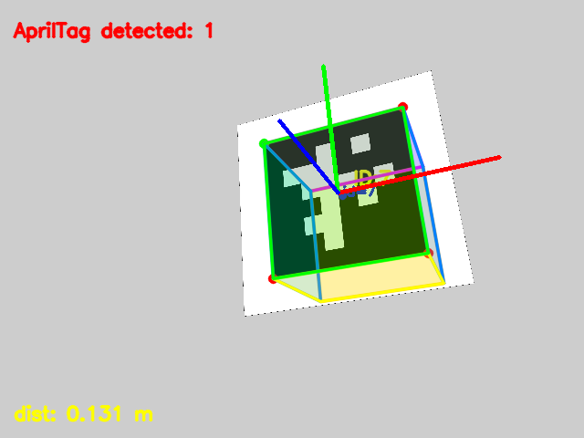

# 视觉作业三：相机标定 + AprilTag 位姿解算与立方体重建

基于 OpenCV 4 的 C++ 程序。用棋盘格标定相机内参，识别画面里的一个 AprilTag 面，用 PnP 解出它在相机坐标系下的位姿，再把立方体的六个面（贴标签的那个面 + 其余五个）投影回图像绘制出来。



> 上图是合成测试图（`assets/test_scene.png`）的运行结果，标签真值距离 0.1307 m。

## 实现内容

1. **相机标定**：离线用棋盘格标定，得到内参矩阵 K 和畸变系数，存成 `camera.yml`
2. **标签检测**：`aruco` 模块识别 `tag36h11`，输出 4 个角点和编号
3. **位姿解算**：`solvePnP` + `SOLVEPNP_IPPE_SQUARE`，得到旋转向量 `rvec` 和平移向量 `tvec`
4. **立方体绘制**：8 个顶点投影、六个面按画家算法排序、半透明填色 + 同色描边
5. **三窗口显示**：原图 / 二值图 / 结果图

## 环境

| 项目 | 版本 |
|---|---|
| 系统 | Ubuntu 22.04 |
| OpenCV | 4.5.4（需要 contrib，用到 `aruco`） |
| C++ | C++17 |
| CMake | 3.16 以上 |

安装 OpenCV 开发包：

```bash
sudo apt install libopencv-dev
```

## 编译

```bash
cmake -S . -B build -DCMAKE_BUILD_TYPE=Release
cmake --build build -j2
```

生成的可执行文件是 `build/homework_3`。

**必须加 `-DCMAKE_BUILD_TYPE=Release`**。不指定构建类型时 CMake 不加 `-O` 优化，自己的循环（填色、逐点投影）会明显变慢。

## 运行

```text
./build/homework_3 <图片路径 | 摄像头编号> [标定文件] [--axes]
```

| 参数 | 是否必填 | 说明 |
|---|---|---|
| 第 1 个 | 是 | 图片路径（按扩展名识别），或纯数字的摄像头编号 |
| 第 2 个 | 否 | 标定文件（`.yml` / `.xml`）。不给就用兜底内参 |
| `--axes` | 否 | 额外画坐标轴，用来验证 z 轴方向 |

**图片模式**（建议先用这个验证 PnP）：

```bash
./build/homework_3 assets/test_scene.png assets/camera_example.yml --axes
```

**摄像头模式**：

```bash
./build/homework_3 0 <你的标定文件>
```

`0` 对应 `/dev/video0`。注意 `/dev/video1` 通常是同一颗摄像头的 metadata 节点，不是第二颗摄像头。

**按键**：图片模式按任意键退出；摄像头模式按 `Esc` 或 `q` 退出，终端会打印处理的总帧数。

## 三个窗口

| 窗口 | 内容 |
|---|---|
| `Image_raw` | 原始图像 / 实时画面 |
| `Image_binary` | 灰度 + 固定阈值二值图 |
| `result` | 标签框、角点、编号、立方体、坐标轴、距离 |

`Image_binary` 只用于展示，**不参与检测**：`detectMarkers` 内部有自己的自适应阈值流程，看不到也改不了。

## 立方体配色

| 面 | 颜色 | BGR |
|---|---|---|
| 正面（贴标签那一面） | 亮绿 | `(0, 255, 0)` |
| 后面 | 橙 | `(0, 165, 255)` |
| 左侧面 / 右侧面 | 亮蓝 | `(255, 128, 0)` |
| 顶面 | 洋红 | `(255, 0, 255)` |
| 底面 | 黄 | `(0, 255, 255)` |

填充透明度 `kAlpha = 0.2`（20% 不透明），边框用该面同色。`cv::Scalar` 的顺序是 **BGR**，不是 RGB。

## 相机标定

标定是**一次性离线步骤**，产出是一个参数文件，所以标定代码不放在本工程里。

用系统自带的交互式标定工具：

```bash
opencv_interactive-calibration -t=chessboard -w=9 -h=6 --sz=25
```

| 参数 | 含义 |
|---|---|
| `-t=chessboard` | 棋盘格模板 |
| `-w=9 -h=6` | **内角点数**（一行 9 个、一列 6 个角点），不是方格数 |
| `--sz=25` | 方格边长 25 毫米 |

仓库里提供了可直接打印的棋盘格：`assets/chessboard_9x6_25mm.png`（9×6 内角点、25 mm 方格，**打印时选 100% 缩放**）。

操作要点：

- 采 15~20 张，角度、距离、位置都要有变化，**要覆盖画面四个角**（畸变在边角最强）
- 重投影误差 **< 0.5 像素**算合格
- 输出文件里 `camera_matrix` 和 `distortion_coefficients` 两个节点，本程序直接能读
- **标定分辨率必须和运行分辨率一致**：`src/main.cpp` 里摄像头设为 640×480，标定也要按 640×480 做

## 文件结构

```text
homework_3_OpenCV/
├── include/
│   ├── Detector.hpp        检测结果结构体 + Detector 声明
│   └── pnp_solver.hpp      FaceDepth + PnPSolver 声明
├── src/
│   ├── Detector.cpp        AprilTag 检测与绘制
│   ├── pnp_solver.cpp      PnP 解算 + 立方体投影绘制
│   └── main.cpp            输入源分流、窗口管理
├── assets/
│   ├── tag36h11_id7.png            4cm 测试标签（含白边静区）
│   ├── test_scene.png              合成测试场景（斜置标签）
│   ├── camera_example.yml          与 test_scene 配套的示例内参
│   └── chessboard_9x6_25mm.png     可打印棋盘格
├── docs/
│   └── example_result.png          README 示意图
├── CMakeLists.txt
├── .gitignore
└── README.md
```

## 实现要点

### 1. 标签坐标系与 z 方向

OpenCV 的标签坐标系是：**x 向右、y 向上、z 从标签正面朝外指向相机**。

所以立方体的实体在标签**背后**，顶点 z 取负值：

```cpp
const float z_back = static_cast<float>(-cube_size_);
```

画错的表现是远面比近面大、盒子像罩在标签前面。验证方法：加 `--axes`，**z 轴（蓝色）应该垂直穿出标签、朝相机方向指**。

### 2. 角点顺序与 IPPE_SQUARE

`SOLVEPNP_IPPE_SQUARE` 是 4 个共面点专用的解析解，比默认的迭代法稳定，在平面目标上不会抖。它要求对象点顺序固定：

```text
点0 (-s/2, +s/2, 0)   点1 (+s/2, +s/2, 0)
点2 (+s/2, -s/2, 0)   点3 (-s/2, -s/2, 0)
```

也就是「左上、右上、右下、左下」，**正好是 `detectMarkers` 返回角点的顺序**，直接传，不需要重排。

### 3. 画家算法

六个面都透明，但边框线不透明，且透明混合有顺序，所以必须排序：

1. 把每个面的 4 个顶点变换到相机坐标系
2. 取 4 个顶点 z 的平均值作为该面的深度
3. **按深度降序排序**，远的先画

`front`（贴标签面）永远最近、`back` 永远最远，四个侧面的顺序随视角变化，所以必须每帧实时算。

### 4. 半透明填充

`cv::fillPoly` 没有 alpha 参数，标准做法是「画在副本上再混合」：

```cpp
cv::Mat overlay = image.clone();
cv::fillPoly(overlay, ..., color, cv::LINE_AA);
cv::addWeighted(overlay, kAlpha, image, 1.0 - kAlpha, 0.0, image);
cv::polylines(image, ..., true, color, kLineWidth, cv::LINE_AA);
```

共用棱会被两个面各描一次，**后画的（更近的面）颜色留在上面**，符合直觉。

### 5. 实时性

- 显式指定 `cv::CAP_V4L2`：默认后端会走 GStreamer，实测掉到 10 fps
- 打开后丢弃前 10 帧（首帧要 1 秒以上完成格式协商）
- 跳过亮度低于 40 的帧（曝光未收敛或环境太暗）
- 循环里用 `waitKey(1)`，不要用视频模式的 `waitKey(30)`，否则延迟翻倍
- 用 640×480 而不是 720p：检测耗时基本只跟图像面积走，分辨率越低延迟越低

## 实测数据

算法耗时（i9-12900H + OpenCV 4.5.4）：

| 环节 | 640×480 | 1280×720 |
|---|---|---|
| 转灰度 | 0.07 ms | 0.14 ms |
| AprilTag 检测 | 0.7 ms | 1.7 ms |
| PnP 解算 | 0.03 ms | 0.03 ms |
| 画立方体（六面填色） | 0.3 ms | 0.8 ms |
| `imshow` + `waitKey(1)` | 1.4 ms | 1.4 ms |
| **合计** | **约 2.5 ms** | **约 4 ms** |

720p 下每帧 4 ms，30 fps 的预算（33 ms）只用了约 12%，瓶颈在采集端。

精度（合成图，真值距离 0.1307 m）：

| 项目 | 结果 |
|---|---|
| PnP 解出距离 | 0.1310 m（误差约 0.3 mm） |
| 角点重投影最大误差 | 0.107 px |
| 画家顺序 | back → top → left → right → bottom → front |

摄像头采集（内置摄像头）：

| 项目 | 结果 |
|---|---|
| 首帧 | 约 1.1 s（仅第一次，驱动初始化） |
| 稳定后 | 32 ms/帧，约 31 fps |
| 分辨率 | 640×480 |

**内参敏感度**：同一场景把 fx 从 544 改成 900，解出距离从 0.131 m 变成 0.215 m。内参错多少，距离就错多少，这就是必须先标定的原因。

## 参数调整

| 参数 | 位置 | 作用 |
|---|---|---|
| `kTagSize` | `src/main.cpp` | 标签实测边长（米），用尺子量黑框外沿 |
| `kCubeSize` | `src/main.cpp` | 立方体边长（米），一般等于标签边长 |
| `kDiscardFrames` | `src/main.cpp` | 摄像头预热丢弃帧数 |
| `kMinBrightness` | `src/main.cpp` | 跳过暗帧的亮度门限 |
| `kAlpha` | `src/pnp_solver.cpp` | 面填充透明度 |
| `kLineWidth` | `src/pnp_solver.cpp` | 描边线宽 |
| `kFaces` | `src/pnp_solver.cpp` | 六个面的顶点索引与颜色 |
| `cornerRefinementMethod` | `src/Detector.cpp` | 角点精化方式（默认亚像素） |

## 已知限制

- **只处理画面里的第一个标签**。多标签场景需要每个标签各解一次位姿、各画一个立方体。
- **平面单标签存在翻转二义性**：数学上有两个解，`IPPE_SQUARE` 内部选一个。标签正对相机时两个解几乎重合，斜得很厉害时可能选错。
- **没有标定时立方体尺寸不可信**：程序会用 `fx = 宽 × 0.85` 猜一组内参，只够看流程是否跑通，并会打印 WARNING。
- **灰度输入可以检测，但彩色标注会退化成黑白**：`result_image` 会保持单通道，绘制颜色只剩第一个分量。正常调用都传 BGR，不影响使用。
- **快速旋转会拖影**：30 fps 下转动太快时标签模糊，检测会丢帧。开灯缩短曝光可以缓解，内置摄像头可能不支持手动曝光。
- **换摄像头或改分辨率必须重新标定**：内参和分辨率绑定。